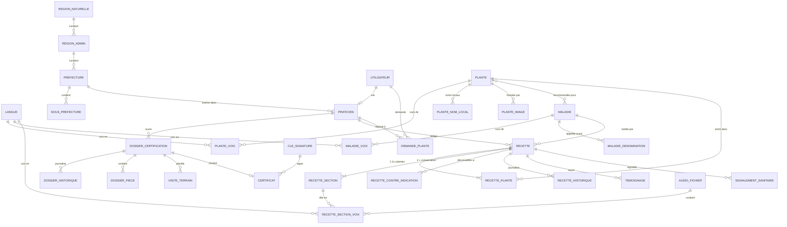

# SABOU — Conception de la base de données (version 2, analyse)

Référence : **cahier des charges v1.3** (`SABOU_Cahier_des_Charges_Vert_v1.3.docx`) et **`04_Regles_Metier.md`** (les numéros R-xxx renvoient aux règles).
Statut : **modèle corrigé, exécuté et testé** (récit US-003, novembre 2026). Les scripts v2, conformes à ce document, ont été exécutés sur PostgreSQL 17 puis remplacés par le paquet `packages/db` du dépôt : migrations versionnées Atlas (`migrations/`, schéma initial et droits du rôle de l'API), jeu d'exemple (`seed/dev.sql`) et requêtes d'exemple (`examples/queries.sql`), tous prouvés par des tests sur un vrai PostgreSQL. Seule correction de fond : un motif obligatoire ne peut plus être vide. La version 1 complète est archivée hors de ce dossier, dans `_archives/conception_v1/`.

---

## 1. Ce qui change entre la version 1 et la version 2

| # | Sujet | Version 1 | Version 2 (conforme au CdC) | Règle |
|---|---|---|---|---|
| 1 | Texte en langue nationale | Noms de plantes écrits en soussou, malinké… | **Aucun texte en langue nationale** : texte en français (+ anglais), voix en langues nationales, libellés en français | R-LNG-02 à 06 |
| 2 | Langues | Un seul type | Indicateurs `texte` (fr, en) et `voix` (fr, sou, mal, pul, gue) | R-LNG-06 |
| 3 | Sections | 4 sans précision | 4 obligatoires + **conservation** facultative | R-REC-02 |
| 4 | Texte des sections | `texte_fr` seul | `texte_fr` + `texte_en` (repli sur le français) | R-LNG-05 |
| 5 | Cycle | Durée, prises | + **pause en jours** ; reprise dans la section cycle | R-REC-04 |
| 6 | Maladie | Un code | Nom fr/en, **symptômes**, **dénominations**, voix du nom par langue | R-MAL-01 |
| 7 | Plantes | Un nom par langue | Nom fr/en écrit, **voix** par langue, **plusieurs noms locaux** (voix + transcription de recherche) | R-PLA-02, R-PLA-03, R-LNG-13 |
| 8 | Contrôle des effets indésirables | Aucun | Contrôle du Comité **par langue** avant publication | R-LNG-12 |
| 9 | Circuit d'un traitement | brouillon / en_validation / certifiée | Brouillon → Soumis → Transmis → Expertisé → Certifié ; Suspendu, Retiré ; historique | R-REC-07, R-SAN-03 |
| 10 | Contre-indications | Texte libre | + liste structurée | R-REC-05 |
| 11 | Rejet de dossier | Statut « rejeté » définitif | Retour à l'étape précédente ; rejet définitif réservé à la DG | R-CER-03, R-CER-04 |
| 12 | Pièces et visites | Absentes | `dossier_piece`, `visite_terrain` | R-CER-06, R-MOD-02 |
| 13 | Certificat | Empreinte SHA-3 seule | SHA3-256 + **signature Ed25519** + clé de signature avec rotation ; révocation motivée ; dossier de renouvellement | R-QR-02 à 07 |
| 14 | Témoignages | Sans réponse ni retrait | **Réponse du praticien**, statut Retiré, remodération après modification | R-TEM-04, R-TEM-05 |
| 15 | Demande de plante | Sans demandeur | **Demandeur** (compte citoyen), nom local en voix et/ou transcription | R-DEM-01, R-DEM-02 |
| 16 | Sécurité sanitaire | Absente | `signalement_sanitaire` (danger + pharmacovigilance) | R-SAN-01 à 03 |
| 17 | Forum | National seulement | Zone (nationale, région, préfecture), suivi des signalements sous 48 h | R-FOR-02, R-FOR-03 |
| 18 | Territoire | Préfecture | + **sous-préfecture** | R-ACC-06 |
| 19 | Site public | Menus et slides | + **historique des publications** ; 7 entrées max dans le header | R-SIT-01, R-SIT-03 |
| 20 | Modules | Absents | Litiges, alertes territoriales, notifications, boutique, paiements, partenaires et clés API, formation, exports, annotations du Comité | R-MOD-01 à 10 |

---

## 2. Modèle conceptuel (entités)

| Domaine | Entités |
|---|---|
| Référentiel | Langue · Région naturelle · Région administrative · Préfecture · Sous-préfecture |
| Comptes | Rôle · Utilisateur · Langue de travail de l'utilisateur |
| Praticiens | Spécialité · Praticien · Abonnement |
| Certification | Dossier de certification · Pièce du dossier · Visite terrain · Historique du dossier · Clé de signature · Certificat |
| Médias | Fichier audio · Image de plante |
| Dictionnaire | Plante · Voix du nom de plante · Nom local de plante · Maladie · Voix du nom de maladie · Dénomination de maladie · Plante–Maladie |
| Traitements | Traitement (recette) · Plante du traitement · Type de section · Section · Voix de section · Contre-indication · Contre-indication du traitement · Historique du traitement · Annotation du Comité |
| Public | Témoignage · Demande de plante · Signalement sanitaire |
| Communauté | Discussion · Message · Signalement de message |
| Pilotage | Litige (+ pièces et échanges) · Alerte territoriale · Notification · Rapport / export |
| Services | Produit · Commande · Paiement · Partenaire · Clé API · Module de formation · Attestation |
| Site | Menu (+ libellés fr/en) · Slide (+ textes fr/en) · Publication du site |
| Traçabilité | Journal d'audit |

---

## 3. Modèle logique (MLD, 3FN)

Notation : **PK**, *FK*, `?` = facultatif. Clés techniques `bigint` identité + code métier unique (PL-001, REC-2041…).

### 3.1 Référentiel et comptes

- langue(**code**, iso639_3, nom_fr, type {officielle, nationale, internationale}, **texte** bool, **voix** bool, active, ordre)
- region_naturelle(**id**, code, nom, *langue_defaut_code* → langue avec voix)
- region_admin(**id**, nom, *region_naturelle_id*)
- prefecture(**id**, nom, *region_admin_id*)
- sous_prefecture(**id**, nom, *prefecture_id*)
- role(**code** {dg, regional, prefectoral, scientifique, praticien, citoyen}, libelle_fr, libelle_en)
- utilisateur(**id**, email, mot_de_passe_hash, prenom, nom, telephone?, *role_code*, *region_admin_id*?, *prefecture_id*?, *langue_interface* (texte), *langue_ecoute* (voix), mfa_actif, mfa_secret_chiffre?, statut {actif, suspendu}, derniere_connexion, created_at, updated_at)
  - contraintes : zone obligatoire selon le rôle ; MFA obligatoire pour dg, regional, prefectoral, scientifique (R-ACC-02, R-ACC-03)
- utilisateur_langue(***utilisateur_id*, *langue_code***, peut_enregistrer, peut_traduire, peut_valider) (R-GOV-06)

### 3.2 Praticiens et certification

- specialite(**id**, code, libelle_fr, libelle_en)
- praticien(**id**, code, *utilisateur_id* unique, *specialite_id*, *prefecture_id*, *sous_prefecture_id*?, *langue_principale* (voix), annees_experience, photo_url?, statut {en_attente, certifie, rejete, suspendu}, note_moyenne, nb_avis, nb_vues)
- abonnement(**id**, *praticien_id*, formule {gratuit, gold, institution}, debut, fin?, montant_gnf, *paiement_id*?)
- dossier_certification(**id**, code, *praticien_id*, type {initial, renouvellement}, visite_requise (toujours vrai pour un dossier initial), etape_courante 1–6, etape_entree_le, statut {en_cours, approuve, rejete_definitif, abandonne}, ouvert_le, cloture_le?)
  - un seul dossier `en_cours` par praticien ; aucun nouveau dossier moins de 12 mois après un rejet définitif (R-CER-04)
- dossier_piece(**id**, *dossier_id*, type {identite, justificatif, photo, compte_rendu_visite, autre}, fichier_url, sha256, *depose_par*, depose_le)
- visite_terrain(**id**, *dossier_id*, *admin_id*, prevue_le, rappel_envoye_le?, realisee_le?, *compte_rendu_piece_id*?, statut {planifiee, realisee, annulee})
- dossier_historique(**id**, *dossier_id*, etape_depart, etape_arrivee, decision {soumis, valide, rejete, rejet_definitif}, motif?, *acteur_id*, decide_le, signature?)
  - motif obligatoire si rejet ; rejet ⇒ etape_arrivee = etape_depart − 1 (R-CER-03)
- cle_signature(**id**, algorithme 'ed25519', cle_publique, active_depuis, revoquee_le?)
- certificat(**id**, numero, *praticien_id*, *dossier_id*, *emis_par*, emis_le, expire_le (≤ emis_le + 12 mois), empreinte_sha3 (64 hex), signature (base64), *cle_id*, statut {actif, expire, revoque}, motif_revocation?, revoque_le?)
  - un seul certificat actif par praticien (R-QR-01)

### 3.3 Médias et dictionnaire

- audio_fichier(**id**, chemin, duree_sec, format, taille_octets, sha256, *enregistre_par*, consentement_voix, consentement_le?, created_at)
- plante(**id**, code, nom_scientifique unique, famille, nom_fr, nom_en?, statut {en_revue, validee}, *valide_par*?)
- plante_image(**id**, *plante_id*, image_url, alt_text_fr, alt_text_en?, type {plante_entiere, feuille, ecorce, racine, produit_prepare, autre}, principale, ordre)
- plante_voix(***plante_id*, *langue_code***, *audio_id*, statut {brouillon, traduit, valide, publie}, *enregistre_par*, *valideur_id*?) — voix du **nom principal** dans chaque langue « voix » (R-PLA-02)
- plante_nom_local(**id**, *plante_id*, *langue_code*, transcription_recherche, *audio_id*?, principal bool) — noms locaux et synonymes ; la transcription sert à la recherche, pas à l'affichage (R-PLA-03, R-LNG-13)
- maladie(**id**, code, nom_fr, nom_en?, symptomes_fr?, symptomes_en?)
- maladie_denomination(**id**, *maladie_id*, langue_code (texte : fr, en), denomination) (R-MAL-01)
- maladie_voix(***maladie_id*, *langue_code***, *audio_id*, statut, *enregistre_par*, *valideur_id*?) (R-MAL-02)
- plante_maladie(***plante_id*, *maladie_id***) — plantes recommandées

### 3.4 Traitements

- recette(**id**, code, *praticien_id*, *maladie_id*, titre_fr, titre_en?, cycle_duree_jours, cycle_prises_par_jour, **cycle_pause_jours**?, image_url?, visibilite {publique, restreinte, privee}, statut {brouillon, soumise, transmise, expertisee, certifiee, suspendue, retiree}, *dossier_id*? (recette jointe au dossier), note_moyenne, nb_avis, publiee_le?)
- recette_plante(***recette_id*, *plante_id***, ordre, partie_utilisee)
- section_type(**code** {preparation, consommation, cycle, effets_indesirables, conservation}, ordre, obligatoire, libelle_fr, libelle_en)
- recette_section(**id**, *recette_id*, *type_code*, texte_fr, texte_en?) unique (recette, type)
- recette_section_voix(***section_id*, *langue_code***, *audio_id*, statut, *enregistre_par*, *traducteur_id*?, *valideur_id*?, *controle_comite_par*?, controle_comite_le?)
  - publication de la voix des effets indésirables ⇒ contrôle du Comité renseigné (R-LNG-12)
- contre_indication(**code**, libelle_fr, libelle_en) — grossesse, allaitement, enfant_moins_5_ans, personne_agee, maladie_chronique…
- recette_contre_indication(***recette_id*, *contre_indication_code***)
- recette_historique(**id**, *recette_id*, statut_depart, statut_arrivee, motif?, *acteur_id*, decide_le)
- annotation_comite(**id**, objet_type {recette, plante}, objet_id, *auteur_id*, contenu, avis {favorable, reserve, defavorable}?, created_at)

Contrôles avant certification d'un traitement (R-REC-06, R-REC-08, R-REC-11) : au moins une plante, toutes validées ; les 4 sections obligatoires ; cycle renseigné ; praticien certifié avec certificat actif ; quota de la formule respecté.

### 3.5 Public et sécurité sanitaire

- temoignage(**id**, *auteur_id*, *recette_id*, note 1–5, contenu, *audio_id*?, *langue_code*, statut {en_attente, publie, rejete, signale, retire}, *modere_par*?, modere_le?, reponse_praticien?, reponse_statut?, reponse_le?, created_at, updated_at) unique (auteur, recette)
- demande_plante(**id**, code, *demandeur_id*, *langue_code*, transcription?, *audio_id*?, *prefecture_id*, *praticien_id*?, *plante_id*?, statut {recue, a_envoyer, envoyee, annulee}, created_at, traitee_le?)
  - transcription ou audio obligatoire (R-DEM-02)
- signalement_sanitaire(**id**, type {danger, effet_indesirable}, objet_type {recette, plante, produit}, objet_id, *auteur_id*?, contact?, description, gravite {faible, moyenne, grave}, *prefecture_id*?, statut {recu, en_examen, clos}, decision {aucune_action, revision, suspension, retrait}?, *traite_par*?, traite_le?, created_at)

### 3.6 Communauté

- forum_discussion(**id**, titre, categorie, portee {nationale, regionale, prefectorale}, *region_admin_id*?, *prefecture_id*?, *auteur_id*, statut {actif, epingle, resolu, a_surveiller}, nb_vues, created_at, derniere_activite)
- forum_message(**id**, *discussion_id*, *auteur_id*, contenu, masque, created_at)
- forum_signalement(**id**, *message_id*, *signale_par*, motif, signale_le, *traite_par*?, traite_le?, decision?)

### 3.7 Pilotage

- litige(**id**, code, objet, *prefecture_id*, *ouvert_par*, *praticien_id*?, statut {ouvert, en_arbitrage, resolu}, decision?, *decide_par*?, decide_le?)
- litige_piece(**id**, *litige_id*, fichier_url, *depose_par*, depose_le) · litige_message(**id**, *litige_id*, *auteur_id*, contenu, created_at)
- alerte_territoriale(**id**, type {hausse_pathologie, desert_therapeutique, dossier_bloque}, *region_admin_id*, *prefecture_id*?, *maladie_id*?, description, statut {nouvelle, accusee, relancee, close}, created_at, accusee_le?)
- notification(**id**, *destinataire_id*, canal {email, sms, application}, modele, objet_type, objet_id, statut {en_attente, envoyee, echec}, envoyee_le?)
- rapport_export(**id**, type, format {pdf, xlsx, csv, json}, periode_debut?, periode_fin?, *demande_par*, fichier_url?, statut, created_at)

### 3.8 Services

- produit(**id**, code, *praticien_id*, nom, description_fr, prix_gnf, stock, statut {brouillon, en_validation, publie, rupture}, *valide_par*?)
- commande(**id**, code, *acheteur_id*, *produit_id*, quantite, montant_gnf, commission_gnf (10 %), *paiement_id*?, statut, created_at)
- paiement(**id**, operateur {orange_money, mtn_momo}, reference_operateur, montant_gnf, objet_type {abonnement, commande}, *payeur_id*, statut {initie, reussi, echoue, rembourse}, created_at, confirme_le?) — l'abonnement et la commande pointent vers leur paiement
- partenaire(**id**, code, nom, type, statut, quota_mensuel)
- cle_api(**id**, *partenaire_id*, prefixe, empreinte, creee_le, expire_le, revoquee_le?)
- formation_module(**id**, code, titre_fr, titre_en?, description_fr) · attestation(**id**, *praticien_id*, *module_id*, delivree_le, numero)

### 3.9 Site et traçabilité

- menu_site(**id**, emplacement {header, footer}, chemin, ordre, visible) — 7 entrées visibles max dans le header (R-SIT-01)
- menu_site_i18n(***menu_id*, *langue_code***, libelle) — langues « texte » seulement
- slide(**id**, image_url, lien, ordre, visible) · slide_i18n(***slide_id*, *langue_code***, titre, texte, bouton, alt_text)
- publication_site(**id**, *publie_par*, publie_le, contenu jsonb) — instantané des menus et slides publiés (R-SIT-03)
- journal_audit(**id**, *utilisateur_id*?, action, objet_type, objet_id, details jsonb, ip, created_at) — ajout seul, partitionné par mois

---

## 4. Diagramme ER (noyau)

---

## 5. Choix de conception (et pourquoi)

| Choix | Raison |
|---|---|
| Une ligne par (objet, langue) pour les voix | Ajouter une langue = une ligne de paramétrage ; chaque voix a son statut et son valideur. |
| Texte français + colonne anglaise, pas de table de traduction générique | Seules deux langues écrites existent (R-LNG-02, R-LNG-05) : deux colonnes sont plus simples et plus lisibles qu'une table i18n. |
| Indicateurs `texte` / `voix` sur la langue | Empêche d'enregistrer une voix en anglais ou un texte en pular ; une future langue nationale se déclare « voix ». |
| Transcription de recherche séparée de l'affichage | Respecte « pas de texte en langue nationale » tout en permettant de retrouver une plante par son nom local (R-LNG-13). |
| Historique des transitions (dossier, traitement) | Chaque décision est horodatée, signée et consultable (CdC §8). |
| Ed25519 + SHA3-256 | L'empreinte identifie le certificat ; la signature prouve qu'il vient de la DG, même hors ligne. |
| Index partiels sur le publié | Le site public ne lit que le certifié et le publié. |
| Recherche trigramme sans accents | Tolérance aux fautes et aux accents (CdC §2.4). |
| Fichiers hors base | Base légère ; audio et images en stockage objet souverain avec empreinte. |

---

## 6. Recommandations (inchangées sur le fond)

**Sécurité** : rôles PostgreSQL séparés (application, lecture analytique, migrations) ; Row-Level Security par zone (préfecture, région) ; mots de passe en argon2id ; TLS 1.3 ; chiffrement au repos ; journal d'audit en ajout seul.

**Sauvegarde** : sauvegarde physique quotidienne + archivage continu des WAL (restauration à un instant donné) ; test de restauration mensuel ; sauvegarde chiffrée séparée du stockage audio.

**Évolutivité** : réplica en lecture pour le site public ; cache des pages de traitements ; partition mensuelle du journal d'audit ; pagination par clé.

**Migrations** : outil versionné, un fichier par changement, jamais de modification d'un script déjà appliqué ; environnements développement, recette, production.

---

## 7. Décisions

Les 6 décisions ouvertes ont été tranchées (novembre 2026) : voir la fin de `04_Regles_Metier.md`. Effets sur le modèle : délai de grâce de 30 jours dans `formule_active` ; colonne `visite_requise` pour les renouvellements ; délai de 12 mois après un rejet définitif ; 8 spécialités ; Conakry en Basse Guinée.
