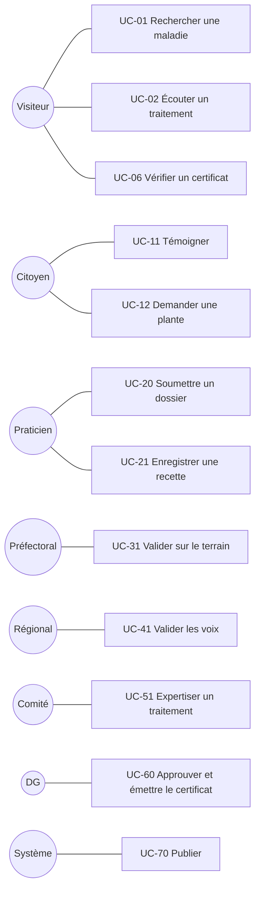

# SABOU — Cas d'utilisation

Source : cahier des charges v1.3 et `04_Regles_Metier.md`. Chaque cas renvoie aux règles (R-xxx) et aux chapitres du cahier des charges (§).
Ces cas d'utilisation sont l'**entrée** du découpage en backlog (`07_Backlog_Sprints.md`).

---

## 1. Acteurs

| Acteur | Description | Compte |
|---|---|---|
| **Visiteur** | Toute personne sur le site public | Aucun |
| **Citoyen** | Utilisateur inscrit (compte gratuit) | Oui |
| **Tradipraticien** | Praticien de la médecine traditionnelle, certifié ou en cours de certification | Oui (application mobile + web) |
| **Admin préfectoral** | Vérification terrain, numérisation, voix locales, modération locale (33) | Oui, double facteur |
| **Admin régional** | Consolidation, validation des voix de sa langue, litiges, alertes (8) | Oui, double facteur |
| **Comité scientifique** | Expertise, fiches plantes, contrôle des effets indésirables, signalements (7) | Oui, double facteur |
| **Direction Générale (DG)** | Approbation, certificats, publication, pilotage du site, comptes (1) | Oui, double facteur |
| **Système** | Tâches automatiques : publication, expiration, notifications, audio, synchronisation | — |
| **Partenaire API** | Institution qui consomme les données anonymisées | Identifiants client OAuth2 |
| **Opérateur Mobile Money** | Orange Money, MTN MoMo | Échanges serveur à serveur |
| **DHIS2** | Système national d'information sanitaire | Échanges serveur à serveur |

## 2. Vue d'ensemble

---

## 3. Cas d'utilisation détaillés (cœur du produit)

### UC-01 — Rechercher une maladie
- **Acteur** : Visiteur (ou Citoyen). **Règles** : R-RCH-01 à 04, R-LNG-08, R-LNG-09, R-REC-10. **§** 2.4, 5.2.
- **Préconditions** : au moins un traitement certifié existe.
- **Scénario nominal** :
  1. Le visiteur saisit un nom de maladie dans la barre de recherche (accueil, Recettes ou Dictionnaire).
  2. Le système cherche dans les noms français et anglais et dans les dénominations, sans tenir compte des accents ni des fautes.
  3. Le système affiche la fiche de la maladie : nom en français, voix du nom dans la langue d'écoute.
  4. Le système affiche une carte par traitement certifié visible : photos et noms des plantes, voix des noms, durée du cycle, note.
  5. Le visiteur ouvre une carte → UC-02.
- **Alternatives** :
  - 2a. Aucun résultat : message clair, suggestions proches, lien vers le Dictionnaire.
  - 3a. Voix absente dans la langue choisie : voix française et mention « traduction en cours ».
  - 4a. Maladie sans traitement certifié : fiche seule, mention « aucun traitement certifié pour l'instant ».
  - 4b. Utilisateur connecté : les traitements « restreints » apparaissent aussi.
- **Postconditions** : la recherche est comptée dans les statistiques (anonymes).

### UC-02 — Consulter et écouter une page traitement
- **Acteur** : Visiteur. **Règles** : R-REC-02, R-REC-05, R-REC-13, R-REC-14, R-LNG-09. **§** 2.5.
- **Préconditions** : traitement certifié et visible pour l'utilisateur.
- **Scénario nominal** :
  1. Le système affiche l'en-tête : maladie, titre, praticien certifié, note.
  2. Il affiche les plantes : photo, nom en français, voix du nom dans la langue d'écoute.
  3. Il affiche les sections dans l'ordre : préparation, consommation, cycle, effets indésirables et contre-indications, conservation (si présente) ; texte en français (ou en anglais), lecteur vocal par section.
  4. Les contre-indications structurées s'affichent en alerte.
  5. Le visiteur écoute, règle la vitesse, lit la transcription française.
  6. Il peut télécharger pour écouter hors réseau (UC-07), partager, signaler un danger (UC-08), donner son témoignage (UC-11).
- **Alternatives** : 3a. Voix manquante → voix française + « traduction en cours ». 6a. Visiteur non connecté qui veut témoigner → invitation à créer un compte.
- **Règle permanente** : mention « SABOU informe, ne prescrit pas ».

### UC-06 — Vérifier un certificat
- **Acteur** : Visiteur. **Règles** : R-QR-02 à 06. **§** 5.2, 9.
- **Scénario nominal** :
  1. Le visiteur saisit le numéro ou scanne le QR.
  2. Le système vérifie la signature Ed25519 avec la clé publique de la DG et le statut du certificat.
  3. Il affiche le verdict en moins de 5 secondes : **vert** (authentique et actif), **ambre** (expiré), **rouge** (inconnu, falsifié ou révoqué), avec la fiche du titulaire et l'empreinte SHA-3 ; verdict annoncé aussi à la voix.
- **Alternatives** : 2a. Sans réseau : la vérification de la signature se fait sur le téléphone avec la clé publique en cache ; le statut « révoqué » n'est connu qu'en ligne (le verdict hors ligne l'indique).

### UC-11 — Déposer, modifier ou retirer un témoignage
- **Acteur** : Citoyen. **Règles** : R-TEM-01 à 07. **§** 2.9.
- **Préconditions** : connecté ; aucun témoignage existant pour ce traitement.
- **Scénario nominal** : 1. Le citoyen note (1 à 5), écrit, enregistre éventuellement sa voix. 2. Le témoignage passe « en attente ». 3. Un modérateur (préfectoral de la zone ou DG) le publie. 4. Les notes du traitement et du praticien sont recalculées. 5. Seuls le prénom et l'initiale sont affichés.
- **Alternatives** : 1a. Témoignage déjà déposé → proposition de le modifier. 3a. Rejet. Modification par l'auteur → retour en attente. Retrait → statut « retiré », notes recalculées. Signalement → retour en modération.

### UC-12 — Envoyer et suivre une demande de plante
- **Acteur** : Citoyen ; Tradipraticien. **Règles** : R-DEM-01 à 05, R-LNG-13. **§** 2.7.
- **Scénario nominal** :
  1. Le citoyen dit le nom local (enregistrement) ou l'écrit comme il le prononce, choisit sa langue et sa préfecture.
  2. Le système propose les plantes correspondantes (transcriptions de recherche) ; le citoyen écoute les noms et reconnaît la plante, ou laisse le praticien décider.
  3. La demande part au praticien certifié le plus proche (même préfecture, sinon même région) — statut « Reçue ».
  4. Le praticien confirme la plante (« À envoyer »), puis l'envoie avec la fiche vocale (« Envoyée ») — UC-23.
  5. Le citoyen suit l'état de sa demande dans son compte.
- **Alternatives** : 3a. Aucun praticien certifié dans la région : demande en attente, alerte à l'admin régional. Annulation par le citoyen.

### UC-20 — Soumettre un dossier de certification
- **Acteur** : Tradipraticien. **Règles** : R-CER-01, R-CER-05, R-CER-06. **§** 4.
- **Scénario nominal** : 1. Le praticien remplit son identité, sa spécialité, sa localité. 2. Il joint ses pièces (identité, justificatifs, photo) et ses recettes vocales. 3. Il soumet : le dossier passe à l'étape 2 ; accusé de réception par SMS.
- **Alternatives** : 3a. Pièce manquante → soumission bloquée. Dossier renvoyé par le préfectoral → corrections puis nouvelle soumission. 3b. Moins de 12 mois après un rejet définitif → soumission refusée.

### UC-21 — Enregistrer une recette dans le Studio SABOU (hors réseau possible)
- **Acteur** : Tradipraticien (ou Admin préfectoral en numérisation, UC-32). **Règles** : R-REC-01 à 04, R-GOV-01, R-LNG-11, R-REC-14, R-DON-04. **§** 2.10, 6.6.
- **Scénario nominal** :
  1. Le praticien choisit la maladie, les plantes (1 à n, ordre, partie utilisée), le cycle (durée, prises, pause).
  2. Pour chaque section et chaque nom de plante, il enregistre sa voix dans sa langue (90 s visées), réécoute, recommence si besoin.
  3. Il donne son consentement (enregistrement et niveau de visibilité).
  4. Il enregistre en brouillon ; sans réseau, tout est gardé sur le téléphone et synchronisé au retour (UC-74).
  5. Il soumet le traitement → UC-22.
- **Alternatives** : 2a. Bruit trop fort → avertissement, nouvel enregistrement. 4a. Conflit de synchronisation → la version validée sur le serveur prime, la sienne reste en brouillon.

### UC-31 — Valider ou rejeter un dossier sur le terrain (étape 2)
- **Acteur** : Admin préfectoral de la préfecture du praticien. **Règles** : R-CER-02, R-CER-03, R-CER-06, R-MOD-02. **§** 4, 6.4.
- **Scénario nominal** : 1. L'admin planifie la visite (UC-30) ; un rappel part au praticien. 2. Il réalise la visite et dépose le compte rendu signé. 3. Il contrôle les pièces. 4. Il valide : le dossier passe à l'étape 3.
- **Alternatives** : 4a. Rejet avec motif obligatoire : retour à l'étape 1, praticien notifié. 4b. Renouvellement sans visite requise : validation sur pièces. 4c. Admin d'une autre préfecture → action refusée.

### UC-60 — Approuver un dossier et émettre le certificat (étape 5)
- **Acteur** : DG. **Règles** : R-CER-01, R-QR-01 à 04, R-QR-07. **§** 4.
- **Scénario nominal** : 1. La DG consulte le parcours daté du dossier. 2. Elle approuve. 3. Le système calcule l'empreinte SHA3-256, signe avec la clé du coffre (Ed25519), génère le QR, crée le certificat (12 mois). 4. Le dossier passe à l'étape 6 → UC-70.
- **Alternatives** : 2a. Rejet motivé → retour à l'étape 4. 2b. Signature par lots pour les renouvellements. 3a. Renouvellement : l'ancien certificat expire à l'émission du nouveau.

---

## 4. Catalogue complet des cas d'utilisation

| ID | Cas d'utilisation | Acteur | Objectif en une phrase | Règles | § |
|---|---|---|---|---|---|
| **UC-01** | Rechercher une maladie | Visiteur | Trouver une maladie et ses traitements certifiés | R-RCH-01 à 04 | 2.4 |
| **UC-02** | Écouter une page traitement | Visiteur | Comprendre et écouter un traitement dans sa langue | R-REC-13/14, R-LNG-09 | 2.5 |
| **UC-03** | Choisir la langue d'écoute | Visiteur | Entendre les ressources dans la langue de sa région ou une autre | R-LNG-07/08 | 2.6 |
| **UC-04** | Consulter l'annuaire | Visiteur | Trouver un praticien certifié par nom, spécialité, lieu, langue | R-CER-08 | 5.2 |
| **UC-05** | Consulter le Dictionnaire | Visiteur | Voir une fiche plante ou maladie, écouter les noms | R-PLA-01 à 04, R-MAL-01 | 5.2 |
| **UC-06** | Vérifier un certificat | Visiteur | Savoir en 5 s si un certificat est authentique, même sans réseau | R-QR-03 à 05 | 5.2 |
| **UC-07** | Télécharger pour écouter hors réseau | Visiteur | Réécouter un traitement sans connexion | R-REC-14 | 8 |
| **UC-08** | Signaler un danger | Visiteur, Citoyen | Alerter le Comité sur un usage dangereux | R-SAN-01 | 2.5 |
| **UC-09** | Lire le forum et les pages institutionnelles | Visiteur | S'informer | R-FOR-01 | 5.2 |
| **UC-10** | Créer un compte citoyen et se connecter | Citoyen | Accéder aux fonctions réservées | R-ACC-01 | 3 |
| **UC-11** | Témoigner | Citoyen | Partager son expérience d'un traitement | R-TEM-01 à 07 | 2.9 |
| **UC-12** | Demander une plante | Citoyen | Obtenir une plante à partir de son nom local | R-DEM-01 à 05 | 2.7 |
| **UC-13** | Participer au forum | Citoyen et comptes | Discuter, répondre, signaler | R-FOR-01 à 04 | 5.2 |
| **UC-20** | Soumettre un dossier de certification | Praticien | Entrer dans le workflow de certification | R-CER-01/06 | 4 |
| **UC-21** | Enregistrer une recette (Studio) | Praticien | Préserver sa recette en voix, même hors réseau | R-REC-01 à 04, R-GOV-01 | 6.6 |
| **UC-22** | Soumettre ou retirer un traitement | Praticien | Faire certifier un traitement, ou le retirer | R-REC-07, R-REC-12 | 2.4 |
| **UC-23** | Répondre à une demande de plante | Praticien | Confirmer et envoyer la plante | R-DEM-03/04 | 6.6 |
| **UC-24** | Répondre à un témoignage | Praticien | Répondre publiquement à un avis | R-TEM-05 | 6.6 |
| **UC-25** | Gérer son profil public | Praticien | Tenir à jour sa fiche d'annuaire | — | 6.6 |
| **UC-26** | Souscrire ou renouveler GOLD | Praticien | Publier plus de 3 traitements, ouvrir la boutique | R-REC-11, R-MOD-06 | 9.1 |
| **UC-27** | Gérer sa boutique | Praticien | Vendre des produits validés | R-MOD-05 | 6.6 |
| **UC-28** | Renouveler son certificat | Praticien | Rester certifié au-delà de 12 mois | R-QR-07 | 4 |
| **UC-29** | Suivre la formation continue | Praticien | Obtenir des attestations | R-MOD-08 | 6.6 |
| **UC-30** | Planifier une visite terrain | Préfectoral | Organiser l'agenda des visites | R-MOD-02 | 6.4 |
| **UC-31** | Valider un dossier sur le terrain | Préfectoral | Décider à l'étape 2 | R-CER-02/03/06 | 4 |
| **UC-32** | Numériser une recette orale | Préfectoral | Saisir une recette pour un praticien, hors réseau | R-GOV-02 | 6.4 |
| **UC-33** | Résumer en français et enregistrer la voix locale | Préfectoral | Produire le texte français et la voix locale | R-GOV-02 | 2.8 |
| **UC-34** | Modérer témoignages et forum local | Préfectoral | Publier ou rejeter les contenus de sa zone | R-TEM-03, R-FOR-02 | 6.4 |
| **UC-35** | Créer un dossier praticien | Préfectoral | Enregistrer un praticien rencontré sur le terrain | R-CER-06 | 6.4 |
| **UC-36** | Envoyer le rapport mensuel | Préfectoral | Rendre compte à l'admin régional | R-MOD-09 | 6.4 |
| **UC-40** | Consolider un dossier | Régional | Décider à l'étape 3 | R-CER-02/03 | 4 |
| **UC-41** | Valider les voix de sa langue | Régional | Garantir la qualité des voix (atelier linguistique) | R-GOV-03, R-GOV-07 | 2.8 |
| **UC-42** | Transmettre un traitement au Comité | Régional | Faire avancer un traitement soumis | R-REC-07 | 6.3 |
| **UC-43** | Arbitrer un litige | Régional | Rendre une décision motivée (dont recours de 30 jours) | R-MOD-01, R-CER-04 | 6.3 |
| **UC-44** | Traiter une alerte territoriale | Régional | Réagir à une hausse, un désert, un dossier bloqué | R-MOD-03 | 6.3 |
| **UC-50** | Expertiser un dossier | Comité | Décider à l'étape 4 | R-CER-01 | 4 |
| **UC-51** | Expertiser un traitement | Comité | Contrôler la non-toxicité et annoter | R-REC-07, R-MOD-10 | 6.5 |
| **UC-52** | Valider une fiche plante | Comité | Rendre une plante utilisable dans un traitement certifié | R-PLA-05/06 | 6.5 |
| **UC-53** | Contrôler les effets indésirables par langue | Comité | Autoriser la publication de ces voix | R-LNG-12 | 6.5 |
| **UC-54** | Traiter un signalement sanitaire | Comité | Décider : aucune action, révision, suspension, retrait | R-SAN-02/03 | 6.5 |
| **UC-60** | Approuver un dossier et émettre le certificat | DG | Décider à l'étape 5 et signer | R-QR-01 à 04 | 4 |
| **UC-61** | Prononcer un rejet définitif | DG | Écarter un praticien frauduleux ou dangereux | R-CER-04 | 4 |
| **UC-62** | Certifier un traitement | DG | Donner le badge « Certifiée » | R-REC-07/09 | 6.2 |
| **UC-63** | Publier les ressources linguistiques | DG | Publier les voix validées, suivre la couverture | R-GOV-05 | 6.2 |
| **UC-64** | Piloter menus et sliders | DG | Modifier le site sans technicien | R-SIT-01 à 04 | 6.7 |
| **UC-65** | Gérer les comptes | DG | Créer, inviter, affecter zone et langues, suspendre | R-ACC-01 à 05 | 6.2 |
| **UC-66** | Gérer partenaires et clés API | DG | Ouvrir les données anonymisées | R-MOD-07 | 6.2 |
| **UC-67** | Consulter tableaux de bord et exports | Tous les admins | Piloter son périmètre | R-MOD-09 | 6 |
| **UC-70** | Publier un praticien (étape 6) | Système | Faire apparaître le praticien et ses traitements | R-CER-01, R-REC-08 | 4 |
| **UC-71** | Expirer les certificats et relancer | Système | Tenir les statuts à jour, prévenir 60 jours avant | R-QR-01, R-QR-07 | 4 |
| **UC-72** | Envoyer les notifications | Système | Informer à chaque transition (SMS, e-mail) | R-MOD-04 | 9 |
| **UC-73** | Traiter l'audio | Système | Réduire le bruit, normaliser, convertir en Opus | R-REC-14 | 8 |
| **UC-74** | Synchroniser les données hors réseau | Système | Remonter les saisies du terrain | R-DON-04 | 8 |
| **UC-75** | Échanger avec les partenaires et DHIS2 | Système | Fournir des indicateurs anonymisés | R-DON-01, R-MOD-07 | 9 |
| **UC-76** | Encaisser un paiement Mobile Money | Système, Opérateur | Activer un abonnement ou payer une commande | R-MOD-06 | 9 |
